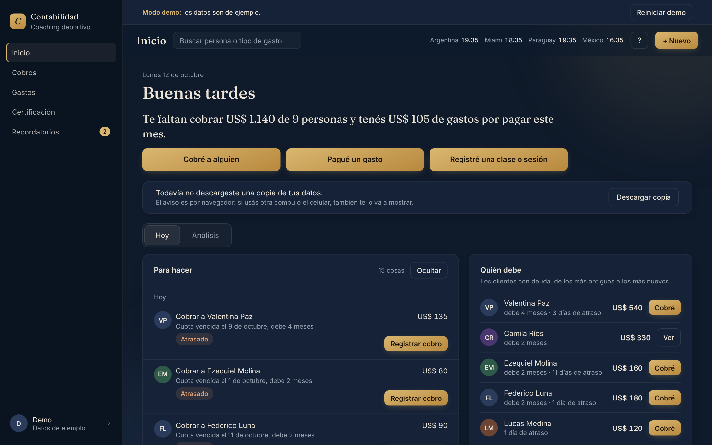
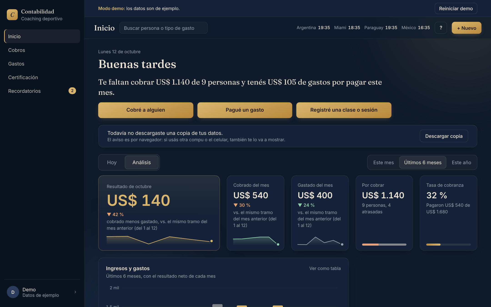
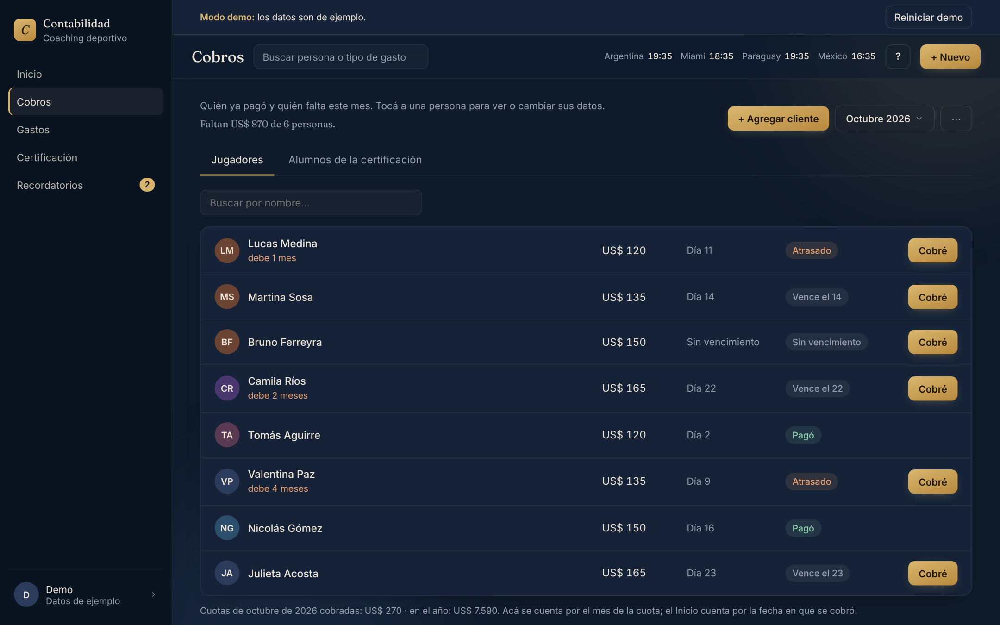
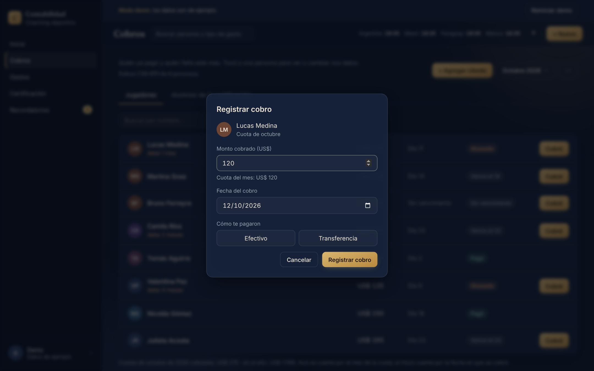
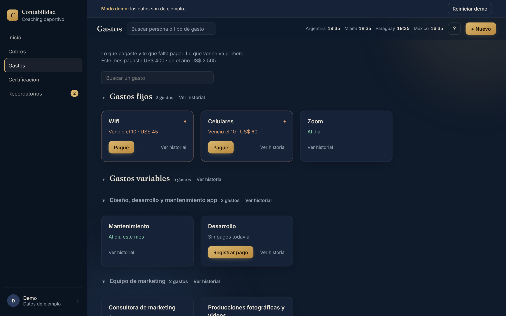

# Sistema de gestión de cobros y gastos

Aplicación web que desarrollé como freelance para la administración de una **consultora de coaching deportivo**. Hoy está **en uso diario**: con ella llevan las cuotas de sus clientes, los gastos del negocio y los pagos al equipo de la certificación que dictan.

> Este repositorio es una versión pública del proyecto: sin claves, sin datos reales y sin el nombre de la clienta. Las capturas son del **modo demo**, que usa datos inventados.



## Qué resuelve

Al entrar, el sistema muestra **qué falta cobrar, qué hay que pagar y qué hacer hoy**, para que no se pase ninguna cuota vencida ni un pago al equipo. Cada movimiento se registra en pocos clics y lo usa una persona sin conocimientos técnicos.

## Funcionalidades

- **Inicio** con dos vistas: *Hoy*, con la lista de cosas para hacer y quién debe, y *Análisis*, con el resultado del mes, la tasa de cobranza y un gráfico de ingresos y gastos de los últimos 6 meses.
- **Cobros** de dos tipos de clientes (jugadores y alumnos de la certificación): monto mensual, día de vencimiento, estado de cada cuota (pagó, vence, atrasado) y meses adeudados.
- **Gastos** organizados en un árbol de categorías editable, con vencimientos, historial y comprobantes adjuntos.
- **Certificación por módulos**: clases y sesiones dictadas, avance de los alumnos y liquidación de los pagos al equipo cuando termina cada módulo.
- **Recordatorios** manuales y sugeridos automáticamente a partir de los datos.
- **Exportación a CSV** y **copia de seguridad** descargable, con instrucciones para restaurarla.
- **Modo demo** (`/demo`): recorre la app completa con datos inventados, sin login y sin tocar la base.

| Análisis | Cobros |
|---|---|
|  |  |
| **Registrar un cobro** | **Gastos** |
|  |  |

## Tecnologías

- **Next.js 14** (App Router) y **React 18**
- **Supabase**: PostgreSQL, Auth y Storage, con **Row Level Security**
- **Rutas de API propias** (`app/api`) que validan la sesión antes de leer o escribir datos
- **Vitest**: **más de 500 tests automatizados** sobre la lógica de negocio
- **Netlify** para el deploy, con una función programada que mantiene activa la base

## Seguridad y datos

- Solo pueden entrar los usuarios de una **lista de administradores**; el registro público está bloqueado a nivel base de datos.
- Todas las tablas tienen **RLS**, así que la clave pública no alcanza para leer nada sin sesión.
- Validaciones de montos, fechas y límites, tanto en el servidor como en la base.
- El esquema completo está versionado en `supabase/migrations`.

## Cómo lo construí

Lo desarrollé con **Claude Code** como herramienta principal. La IA me sirvió para generar e iterar rápido, pero las decisiones las tomé yo:

- Primero definí con la clienta qué necesitaba y diseñé el modelo de datos.
- Antes de dar un cambio por bueno, lo reviso, lo pruebo en el navegador y corro los tests.
- Registré las auditorías, verificaciones y decisiones en [`docs/`](docs) y el historial completo en [`CHANGELOG.md`](CHANGELOG.md).
- Las mejoras salieron del uso real: lo que costaba entender o hacía perder tiempo se simplificó (ver [`docs/SIMPLIFICACION.md`](docs/SIMPLIFICACION.md) y [`docs/CRITERIOS-DE-USO.md`](docs/CRITERIOS-DE-USO.md)).

## Correrlo en local

```bash
npm install
cp .env.local.example .env.local   # completar con los datos de tu proyecto de Supabase
npm run dev                         # http://localhost:3000
npm test                            # corre los tests
```

Para ver la app sin configurar nada, abrí **`/demo`**: funciona sin Supabase y con datos de ejemplo.

## Estructura

```
app/            páginas (App Router) y rutas de API en app/api
components/     interfaz: inicio, cobros, gastos, certificación, ventanas
lib/            lógica de negocio, validaciones y sus tests (*.test.js)
supabase/       migraciones SQL (tablas, RLS, funciones)
scripts/        restauración de copias de seguridad
docs/           documentación técnica, auditorías y capturas
```

Documentación técnica completa: [`docs/DOCUMENTACION-TECNICA.md`](docs/DOCUMENTACION-TECNICA.md).

---

Desarrollado por **[Facundo Artola](https://github.com/facuartola)** · [LinkedIn](https://www.linkedin.com/in/facundoartola)
