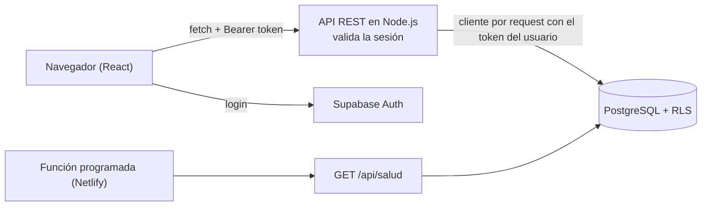

# Sistema de gestión de cobros y gastos

Aplicación web full stack para la administración de una **consultora de coaching deportivo**. La desarrollé como freelance y está **en producción, con uso diario**: la clienta lleva ahí las cuotas de sus clientes, los gastos del negocio y los pagos al equipo de la certificación que dicta.

> Versión pública del proyecto: sin claves, sin datos reales y sin el nombre de la clienta. Las capturas son del **modo demo**, que usa datos inventados.

**[▶ Demo en video (45 s)](https://youtu.be/8ZTCAMH56X0)**


`JavaScript` `React 18` `Next.js 14` `Node.js` `PostgreSQL` `Supabase` `Vitest` `Netlify`

## Qué resuelve

Al entrar, el sistema muestra **qué falta cobrar, qué hay que pagar y qué hacer hoy**. Lo usa una persona sin conocimientos técnicos, así que cada operación se resuelve en pocos clics y los mensajes de error están escritos para ella, no para un desarrollador.

## Funcionalidades

- **Cobros** de dos tipos de clientes (jugadores y alumnos): monto mensual, día de vencimiento, estado de cada cuota y meses adeudados.
- **Gastos** en un árbol de categorías editable, con vencimientos, historial y comprobantes adjuntos.
- **Certificación por módulos**: clases dictadas, avance de los alumnos y cálculo de los pagos al equipo al cerrar cada módulo.
- **Panel de Inicio** con resultado del mes, tasa de cobranza y gráfico de los últimos 6 meses.
- **Recordatorios** manuales y sugeridos a partir de los datos.
- **Exportación a CSV** compatible con Excel en configuración regional argentina, y **copia de seguridad** descargable con script de restauración.
- **Modo demo** (`/demo`): la app completa con datos inventados, sin login y sin tocar la base.

| Análisis | Cobros |
|---|---|
|  |  |
| **Registrar un cobro** | **Gastos** |
|  |  |

## Arquitectura



- **El frontend nunca habla directo con las tablas.** Todas las lecturas y escrituras pasan por la API propia (`app/api`, 31 rutas REST).
- **Cada request crea un cliente de Supabase con el token del usuario** (`lib/supabaseServer.js`). Así las políticas de **Row Level Security** se evalúan como ese usuario y no como anónimo.
- **La sesión se valida explícitamente** antes de consultar (`lib/apiAuth.js`). Sin este chequeo, una sesión vencida devolvía listas vacías con 200 en lugar de un 401, y la interfaz mostraba "no hay datos" en vez de pedir login.
- **La lógica de negocio vive en `lib/`**, separada de las rutas y de los componentes, y es lo que cubren los tests.

## Decisiones técnicas

- **Seguridad en dos capas.** La API valida la sesión, y además la base tiene RLS en todas las tablas con una lista de administradores. La función `es_admin` es `security definer` y está en un esquema privado para que no se pueda llamar desde la API pública. El registro de usuarios nuevos está bloqueado a nivel base.
- **Validación en API y en base.** Montos, fechas y límites se validan en el servidor (`lib/validacion.js`) y también con constraints en PostgreSQL, por si algún día otro cliente escribe en la base.
- **Rutas compartidas en lugar de duplicadas.** Jugadores y alumnos tienen las mismas operaciones; en vez de seis archivos casi iguales, las rutas salen de una fábrica (`lib/rutasPersonas.js`) con la configuración de cada tipo.
- **Esquema versionado.** Las 17 migraciones de `supabase/migrations` reconstruyen la base completa, y el script de restauración se prueba contra ellas con una base Postgres en memoria (PGlite).
- **Fallas aisladas.** Cada bloque del Inicio tiene su propio límite de error: si un cálculo falla, se muestra un mensaje con "Reintentar" y el resto de la pantalla sigue funcionando. Los errores se registran en una tabla `errores_app`.
- **Fechas en hora de Argentina.** Vencimientos y "hoy" se calculan siempre en `America/Argentina/Buenos_Aires` (`lib/fechas.js`), independientemente de la zona del servidor.

## Tests

**503 tests en 41 archivos** con Vitest, sobre la lógica de negocio: cálculo de deudas y cuotas, validaciones, armado del CSV, copia de seguridad, agrupación de gastos y textos de la interfaz.

```bash
npm test
```

## Correrlo en local

Requiere Node.js 20 o superior.

```bash
npm install
cp .env.local.example .env.local   # completar con los datos de tu proyecto de Supabase
npm run dev                         # http://localhost:3000
```

Para verla sin configurar nada, abrí **`/demo`**: funciona sin Supabase y con datos de ejemplo.

## Estructura

```
app/            páginas (App Router) y rutas de la API REST en app/api
components/     interfaz: inicio, cobros, gastos, certificación, ventanas
lib/            lógica de negocio, validaciones y sus tests (*.test.js)
supabase/       migraciones SQL (tablas, RLS, funciones, triggers)
netlify/        función programada
scripts/        restauración de copias de seguridad
docs/           documentación técnica y capturas
```

Documentación técnica completa en [`docs/DOCUMENTACION-TECNICA.md`](docs/DOCUMENTACION-TECNICA.md). Las notas de desarrollo y verificaciones de cada iteración están en [`docs/desarrollo/`](docs/desarrollo/).

---

Desarrollado por **[Facundo Artola](https://github.com/facuartola)** · [LinkedIn](https://www.linkedin.com/in/facundoartola)
